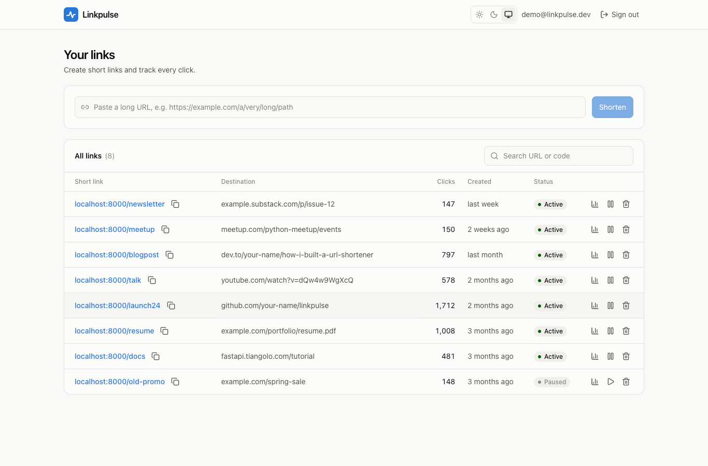
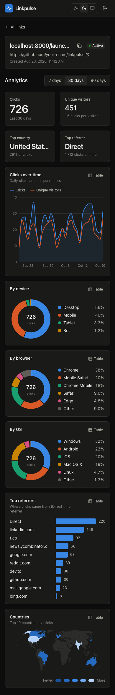
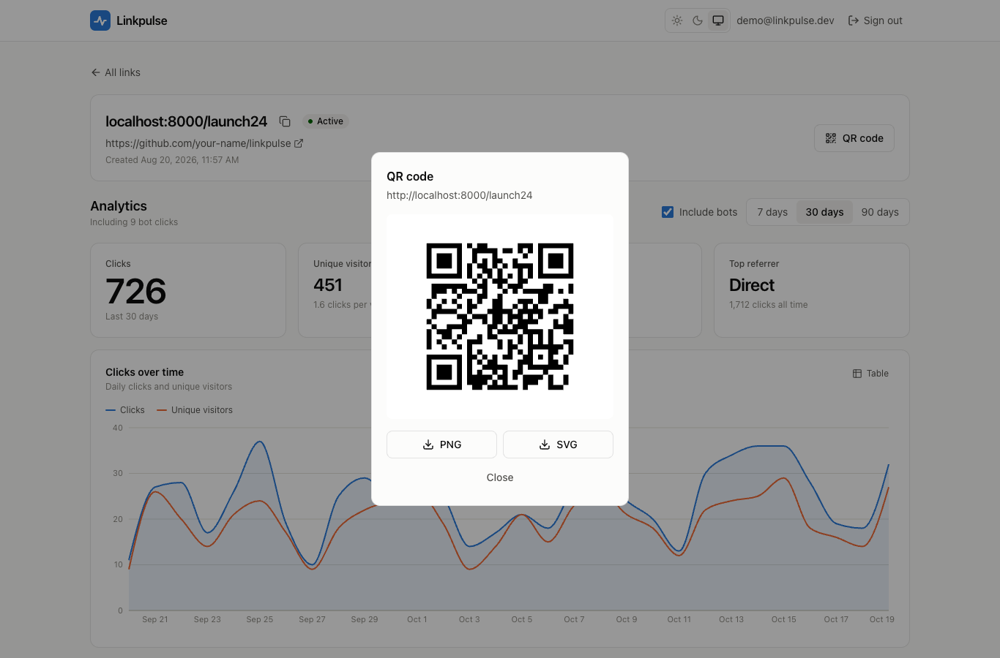
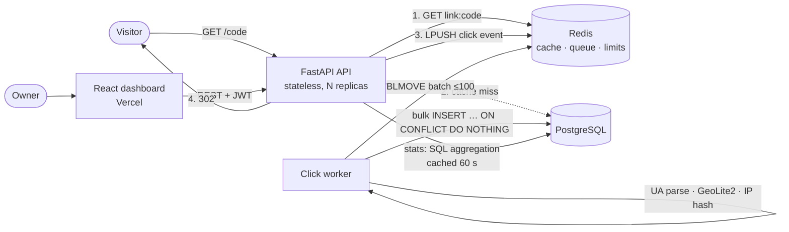

# Linkpulse

**A URL shortener with a real-time analytics dashboard.** The redirect path stays fast with Redis caching, and every click is processed asynchronously into per-link analytics.

**Live demo:** _coming soon: `https://<your-frontend>.vercel.app`_ (sign in with **Explore the demo account**)

[](https://github.com/AngelLondhe/linkpulse/actions/workflows/ci.yml)
[](https://codecov.io/gh/AngelLondhe/linkpulse)


## Screenshots

| Analytics (light) | Analytics (dark) |
| --- | --- |
|  |  |

| Links | Mobile | QR code |
| --- | --- | --- |
|  |  |  |

> 🎬 _Demo GIF placeholder: record creating a link, clicking it, and watching the dashboard update._

## Features

**Core**
- Shorten any http/https URL into a random 7-character Base62 code
- `GET /{code}` → **302** redirect served from Redis, with Postgres as the source of truth
- Per-click analytics: time, referrer, browser, OS, device type, country, city, and a **salted IP hash** (raw IPs are never stored)
- Accounts with JWT auth. Users can only see and change their own links.
- Dashboard: searchable, paginated links table (copy, pause/resume, delete) and a per-link analytics page with KPI cards, clicks over time (7d/30d/90d), device/browser/OS donuts, top referrers and a world map. Every chart has a table view.

**Extras**
- Custom aliases (with a reserved-word blocklist)
- Link expiry by date or by max clicks (link previews don't use up the budget)
- Password-protected links (Argon2id, brute-force rate limited)
- QR codes (PNG/SVG)
- Unique vs total visitors
- A hand-written Redis **sliding-window rate limiter**
- Bot and crawler filtering (Slack/WhatsApp unfurlers, crawlers, scripts)
- Google Safe Browsing check on destination URLs
- Dark mode, mobile layout, skeletons, empty and error states, toasts

## Architecture



The redirect path does **one Redis GET and one Redis LPUSH** on a cache hit. It does no UA parsing, no geo lookup and no database writes. A separate worker enriches clicks in batches. See **[docs/ARCHITECTURE.md](docs/ARCHITECTURE.md)** for flows, the data model and failure modes.

## Tech stack

| Layer | Choice |
| --- | --- |
| API | Python 3.12, FastAPI (async), SQLAlchemy 2 (async) + asyncpg, Alembic, Pydantic v2, pydantic-settings |
| Data | PostgreSQL 16, Redis 7 (cache, click queue, rate limits, click budgets) |
| Worker | asyncio process: `user-agents`, MaxMind GeoLite2 (offline), HMAC-SHA256 IP hashing |
| Frontend | React 19, Vite, TypeScript, Tailwind CSS 4, TanStack Query, React Router, Recharts, react-simple-maps |
| Quality | pytest + pytest-asyncio + httpx (real Postgres/Redis), pytest-cov (95%), ruff, mypy `--strict`, oxlint, Locust |
| Infra | Docker Compose (postgres, redis, migrate, api, worker, frontend), GitHub Actions |

## Design decisions

The full log (80+ entries, each with its reason) is in **[docs/DECISIONS.md](docs/DECISIONS.md)**. These are the main ones.

**Code generation and collisions.** Codes are 7 random characters from a 62-character alphabet, generated with `secrets`. That gives 62⁷ ≈ 3.5 trillion possible codes, and they're unguessable and non-sequential, so nobody can enumerate other people's links. Collisions are handled **optimistically**: insert, and if the unique index rejects it, retry with a new code (at most 5 attempts, then a 503). A "SELECT first, then INSERT" check would race under concurrency; the unique index is the single source of truth. Only violations of *that specific* index are retried.

**302, not 301.** Browsers cache a 301 permanently, so repeat visits would never reach the server and never be counted. A 302 with `Cache-Control: private, no-store` sends every click through the API. It also lets an owner change a link's destination later.

**Async click logging.** The redirect only pushes a raw event onto a Redis list. A worker moves batches of up to 100 into its own *processing list* (`BLMOVE` plus a Lua script), enriches them, bulk-inserts them, and only then clears the processing list. A crash at any point leaves the batch in Redis to be retried, and inserts are idempotent on a per-event UUID, so a retry can't double-count. If Redis is down, the API writes the click itself in a background task *after* sending the redirect.

**IP hashing for privacy.** IPs are stored only as `HMAC-SHA256(secret salt, ip)`, which is enough to count unique visitors. The salt is a server secret because the IPv4 space is small enough to brute-force otherwise. The raw IP exists only briefly in the Redis queue, because the worker needs it for the offline geo lookup.

**Bot filtering.** Link unfurlers (Slack, WhatsApp, Discord), crawlers and HTTP libraries are flagged by a cheap precompiled regex on the request path and by the full UA parser in the worker. Bots are stored, but analytics exclude them by default (`include_bots=true` shows them), and they never use up a link's `max_clicks`. Pasting a single-use link into Slack doesn't burn it.

**Cache invalidation.** Redirect entries are cache-aside with a 1-hour TTL, capped at the link's expiry. Every write path (create, edit, pause, delete) deletes the key, and so does reaching the expiry or click limit. Unknown codes are negatively cached for 60 seconds, and creating a link clears that entry. If Redis is unreachable, reads fall back to Postgres (0.5 s socket timeouts make this fail fast), so Redis is an accelerator, not a dependency for correctness.

**Also worth asking about:**
- `max_clicks` is enforced with an atomic Lua counter because the clicks table lags behind the async worker.
- The rate limiter is a sliding-window counter in one Lua call, which avoids the fixed-window double burst.
- `X-Forwarded-For` is trusted only from configured proxies and read right to left.

## Performance

Redirect benchmark (`GET /{code}`, redirects not followed), measured with Locust:

| Mode | Requests | Failures | Req/s | p50 | p95 | p99 |
| --- | ---: | ---: | ---: | ---: | ---: | ---: |
| Redis cache **on** | 210,972 | 0 | 3,574 | 2 ms | 5 ms | 10 ms |
| Redis cache **off** (Postgres on every hit) | 142,191 | 0 | 2,409 | 14 ms | 29 ms | 49 ms |

**Conditions.** One Apple M2 laptop (8 cores, 8 GB) **on battery power**, with the API, Postgres 15, Redis and Locust all on the same machine. 2 uvicorn workers, 100 concurrent users, 60 s per mode after a 10 s warm-up, rate limiting off, 1,000 links (95% existing codes, 5% unknown).

**How to read this.** The cache cuts median latency about **7×** (14 → 2 ms) and p99 about **5×**. Throughput rises only about 1.5×, probably because the single Locust process shares the CPU and caps request rate before the API does. These are lower-bound, single-machine numbers, not production capacity. Reproduce with `backend/benchmarks/run_benchmark.sh` ([instructions](backend/benchmarks/README.md)). For deployed numbers, run Locust from another machine against the live API.

## API overview

Interactive docs: `http://localhost:8000/docs`. Errors always look like `{"error": {"code", "message", "details"}}`.

| Method | Path | Description |
| --- | --- | --- |
| `POST` | `/api/auth/register` | Create an account → `{access_token, user}` |
| `POST` | `/api/auth/login` | Sign in → `{access_token, user}` |
| `GET` | `/api/auth/me` | Current user |
| `POST` | `/api/links` | Create: `url`, optional `custom_alias`, `expires_at`, `max_clicks`, `password` |
| `GET` | `/api/links?q=&page=&page_size=` | Your links (search + pagination) |
| `GET` / `PATCH` / `DELETE` | `/api/links/{id}` | Read / partial update (`null` clears a limit) / delete |
| `GET` | `/api/links/{id}/stats?from=&to=&tz=&include_bots=` | Totals, uniques, zero-filled daily series, top-10 breakdowns |
| `GET` | `/api/links/{id}/qr?format=png\|svg` | QR code image |
| `GET` | `/{code}` | 302 redirect (password form for protected links) |
| `GET` | `/api/health` | Postgres/Redis status |

Status codes: `401` unauthenticated · `403` not your link · `404` unknown · `409` alias taken · `410` expired or click limit reached · `422` validation · `429` rate limited (with `Retry-After`).

## Run it locally

**With Docker (everything):**

```bash
cp .env.example .env
docker compose up --build
docker compose exec api python -m scripts.seed   # demo user + ~5,000 clicks over 90 days
```

- Dashboard: http://localhost:5173 (click **Explore the demo account**)
- API docs: http://localhost:8000/docs
- Optional: put `GeoLite2-City.mmdb` in `backend/data/` for country/city data ([how](backend/data/README.md))

**Without Docker (for development):** needs Python 3.12, Node 22, Postgres and Redis.

```bash
cp .env.example .env
# Backend
cd backend && python3.12 -m venv .venv && source .venv/bin/activate
pip install -r requirements-dev.txt
alembic upgrade head && python -m scripts.seed
uvicorn app.main:app --reload --no-proxy-headers     # API on :8000
python -m app.worker                                  # in a second terminal
# Frontend
cd ../frontend && npm install && npm run dev          # http://localhost:5173
```

## Testing

```bash
cd backend
createdb shortener_test                    # tests use this DB and Redis DB 15, never your dev data
pytest --cov                               # 244 tests, ~95% coverage (CI gate: 80%)
ruff check . && ruff format --check . && mypy app tests scripts benchmarks
cd ../frontend && npm run lint && npm run typecheck && npm run build
```

Integration tests run against **real** Postgres and Redis. The schema is rebuilt from the Alembic migrations, and each test starts with truncated tables and an empty Redis. Coverage includes:

- redirect → worker → stats end to end
- worker crash recovery and idempotent retries
- Redis outages (redirect, stats, click budget, rate limiter)
- cache invalidation after edits
- expiry and max-clicks
- alias collisions and ownership (403)
- malformed URLs
- password links
- the rate limiter's window math

## Project structure

```
backend/
  app/
    routers/      HTTP only: parse, call a service, shape the response
    services/     business logic (links, redirect, cache, queue, stats, limits, rate limiter, ...)
    models/       SQLAlchemy models        schemas/  Pydantic request/response models
    utils/        pure helpers (codes, URL validation, UA, bots, IP hash, client IP)
    worker/       click worker (python -m app.worker)
  alembic/        migrations              tests/    unit + integration
  scripts/seed.py demo data               benchmarks/  Locust load test
frontend/src/     pages, components (charts), hooks (TanStack Query), lib (API client, auth, theme)
docs/             ARCHITECTURE.md · DECISIONS.md · DEPLOY.md
```

## Deployment

**[docs/DEPLOY.md](docs/DEPLOY.md)** covers each piece: Render or Fly.io (API and worker), Neon or Supabase (Postgres), Upstash (Redis) and Vercel (frontend), with every environment variable.

## Future improvements

- A dedicated short domain, and a branded HTML 404/410 page for visitors
- An "Edit link" dialog in the UI (the API already supports full PATCH)
- httpOnly-cookie sessions with refresh tokens instead of a localStorage JWT
- HyperLogLog for unique visitors at very high volume, and pre-aggregated daily rollups for old data
- Partitioning `clicks` by month, with retention policies
- Redis Streams with consumer groups once more than a few workers are needed
- Live updates via Server-Sent Events instead of 30-second polling
- Prometheus metrics and OpenTelemetry tracing for the redirect path and queue depth
- Playwright end-to-end tests in CI (the dashboard was verified with headless Chrome during development)
