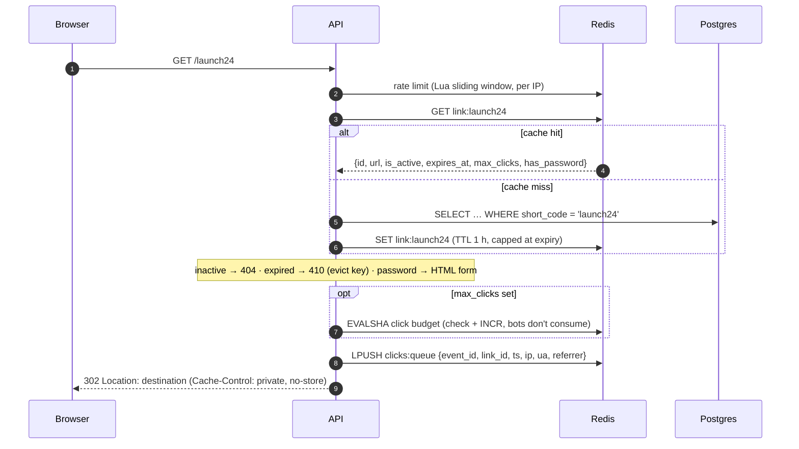
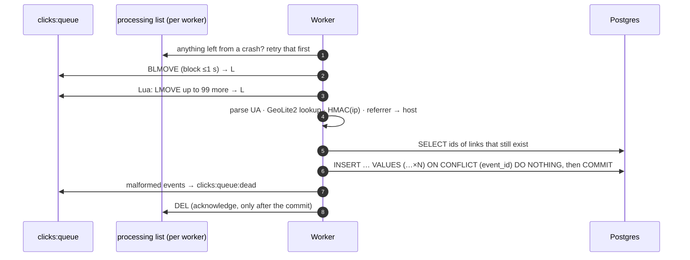
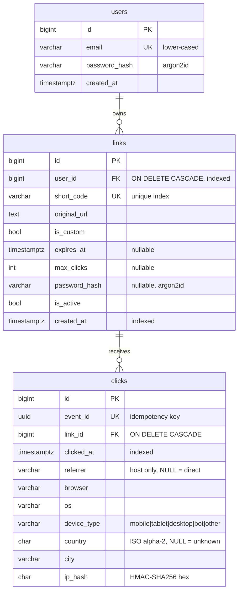

# Architecture

## Components

| Component | Process | Responsibility |
| --- | --- | --- |
| **API** | `uvicorn app.main:app` (stateless, scale horizontally) | Auth, link CRUD, stats, QR codes, and the redirect hot path |
| **Worker** | `python -m app.worker` (one or more, each with a unique `WORKER_ID`) | Drains click events: UA parsing, geo lookup, IP hashing, bulk insert |
| **PostgreSQL** | | Source of truth: users, links, clicks |
| **Redis** | | Redirect cache, click queue, `max_clicks` counters, rate-limit windows, stats cache |
| **Frontend** | Static SPA (nginx / Vercel) | Dashboard. Talks to the API with a Bearer JWT. |
| **migrate** | one-shot `alembic upgrade head` | Runs before the API and worker start |

The code is layered so each layer can be tested on its own:

```
routers/   HTTP only: validate input (schemas), call one service, shape the response
services/  business rules, transactions, cache/queue logic   (no FastAPI imports except DI)
models/    SQLAlchemy tables         schemas/  Pydantic I/O models
utils/     pure functions (code generation, URL validation, UA/bot detection, hashing, client IP)
```

## Redirect: `GET /{code}`



On a cache hit, the request costs at most four Redis round trips (rate limit, GET, optional budget, LPUSH) and **zero** Postgres queries. The SQLAlchemy session is created lazily, so it never even takes a pool connection.

## Click pipeline (worker)



**Delivery guarantees.**
- Each event is always in exactly one Redis list (queue → processing), and moves happen atomically.
- A crash before the commit means the batch is retried.
- A crash after the commit but before the acknowledgement means a retry that the `event_id` unique index makes a no-op.

Together that's **at-least-once processing with effectively-once storage**.

## Data model



**Indexes.** `clicks(link_id, clicked_at)` serves every stats query as an index range scan (checked with `EXPLAIN`). Its leftmost prefix also covers "clicks for link X", so there's no separate `link_id` index. Schema changes go only through Alembic. There are two migrations so far: the initial schema, then `event_id`.

## Stats

Everything in the stats response is computed in SQL. The `(link_id, clicked_at)` index is used throughout, because the requested local-day window is converted to half-open UTC bounds before querying.

- **Totals:** `COUNT(*)`, `COUNT(DISTINCT ip_hash)`, and bots counted separately with `COUNT(*) FILTER (WHERE device_type = 'bot')`.
- **Timeseries:** `generate_series(from, to, '1 day')` LEFT JOINed to per-day `GROUP BY (clicked_at AT TIME ZONE :tz)::date` counts, so every day is present, with zeros where there were no clicks.
- **Breakdowns:** `GROUP BY COALESCE(col, 'Unknown') ORDER BY count DESC, label LIMIT 10` for each dimension.

Results are cached in Redis for 60 s (`stats:{link}:{from}:{to}:{tz}:{bots}`) *after* an ownership check that always goes to Postgres.

## Failure modes

| Failure | Behavior |
| --- | --- |
| Redis down during a redirect | Cache read becomes a miss, and Postgres serves the link. The click event is written to Postgres by a background task after the 302. `max_clicks` is checked against the Postgres count. The rate limiter fails open. `/api/health` reports `degraded` (200). |
| Redis down during an edit | Cache invalidation is logged at ERROR. The stale entry lives at most until its TTL (≤1 h, ≤ link expiry). |
| Postgres down | Cached redirects keep working. Uncached redirects, CRUD and stats return 500. `/api/health` returns 503. |
| Worker crash / deploy | The in-flight batch stays in `clicks:queue:processing:{WORKER_ID}` and is retried first on restart. SIGTERM finishes the current batch before exiting. |
| DB error during an insert | The batch stays in the processing list. The worker retries with exponential backoff (up to 30 s). |
| Event for a deleted link | Filtered out before the insert, so it can't poison the batch through an FK violation. |
| Malformed event | Moved to `clicks:queue:dead` for inspection. |
| GeoLite2 file missing or corrupt | Logged once. Country and city are stored as NULL and shown as "Unknown". |
| Safe Browsing slow or down | 2 s timeout, then the URL is allowed (fail open). |

## Scaling notes

- **API:** stateless, so add replicas. Rate limits and click budgets live in Redis, so they hold across replicas.
- **Workers:** run several, each with a unique, stable `WORKER_ID`. Batching means each worker handles about 100 events per transaction.
- **Postgres:** the clicks table grows fastest. Next steps are monthly partitioning, daily rollup tables for old data, and HyperLogLog for unique visitors.
- **Redis:** AOF persistence protects queued clicks. Multi-key Lua scripts use `{hash tags}`, so they're also compatible with Redis Cluster.
